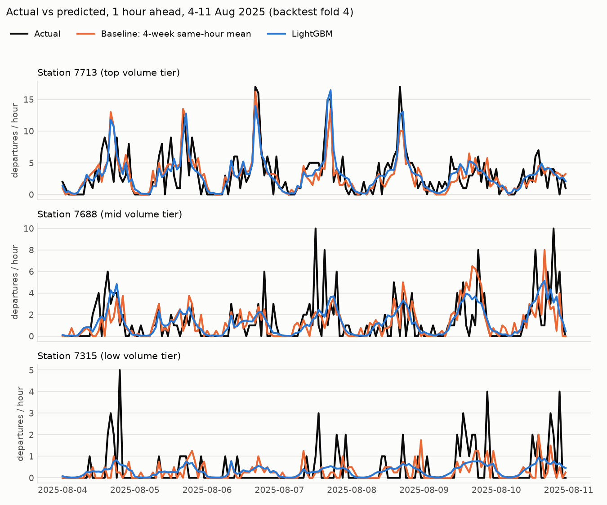

# Toronto Bike Share demand forecaster

Hourly departure forecasts per Bike Share Toronto station, 1 and 3 hours ahead, built from public
data. LightGBM (Poisson objective) against two baselines, scored with a rolling-origin backtest and
a held-out 2026 test.

## Results

Test set: Jan-Sep 2026, 5.6M station-hours at established stations, scored once.

| RMSE | 1 h ahead | 3 h ahead |
|---|---|---|
| Predict zero | 3.244 | 3.244 |
| Same hour last week | 2.314 | 2.314 |
| Mean of same hour, last 4 weeks | 1.876 | 1.876 |
| LightGBM | 1.590 | 1.688 |

LightGBM improves RMSE over the best baseline by 15.3% (1 h) and 10.0% (3 h).



Full tables and slices: [reports/results.md](reports/results.md).

## Setup

Requires Python 3.11 and [uv](https://docs.astral.sh/uv/).

```bash
make setup      # install dependencies
make ingest     # download trips and weather into data/raw
make process    # clean, join weather, aggregate -> data/processed/station_hourly.parquet
```

```bash
make features baselines train backtest   # features, baselines, grid search, tables, figures
make final                               # train 2023-2025, score 2026-01..09; runs once
make test                                # ruff + pytest
```

```python
import polars as pl

panel = pl.read_parquet("data/processed/station_hourly.parquet")
print(panel.select("station_id", "hour", "departures", "arrivals", "temp_c").head())
```

MLflow runs: `uv run mlflow ui --backend-store-uri mlruns`.

## Layout

```text
config/config.yaml   paths, URLs, years, cleaning thresholds
src/bikeshare/       ingest, clean, weather, aggregate, features, baselines, train, evaluate, report
tests/               unit tests and data tests (marker: data)
reports/             result CSVs, results.md, figures
docs/data-notes.md   data sources, cleaning, data quality
```

`data/` and `mlruns/` are git-ignored.
