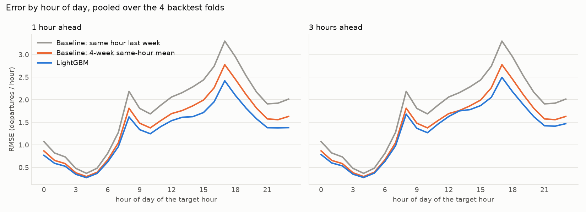
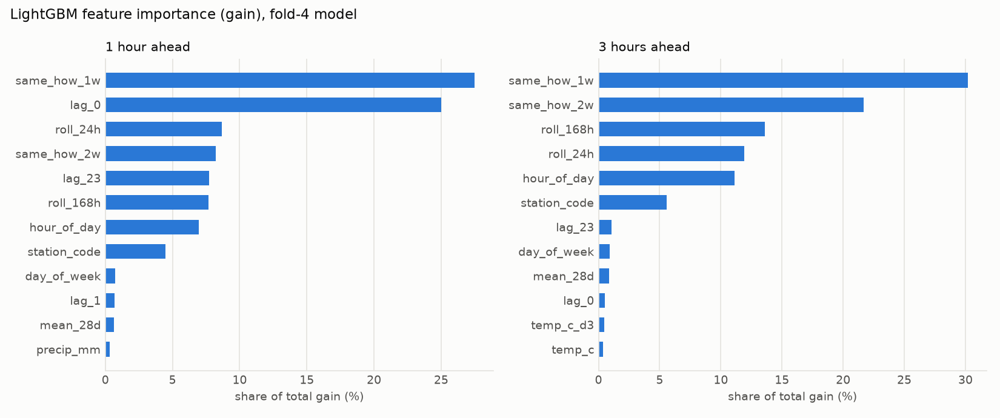

# Data notes

## Sources

| Source | Content |
|---|---|
| City of Toronto Open Data, "Bike Share Toronto Ridership Data" | Trips, one zip per year, 2023 to Sep 2026 |
| Environment Canada hourly CSV, station 48549 (Toronto City Centre) | Temperature, precipitation, wind, humidity, visibility, pressure; 0.2-0.3% null hours |

Paths, URLs, years and thresholds are in [config/config.yaml](../config/config.yaml).

## Schema differences between years

| | 2023 | 2024-2026 |
|---|---|---|
| Headers | `Trip  Duration` (two spaces), UTF-8 BOM | `Trip_Duration`, no BOM |
| Timestamps | `MM/DD/YYYY HH:MM` | `YYYY-MM-DD HH:MM:SS` |
| User type | `Casual Member` / `Annual Member` | `Casual` / `Member` |
| Extra columns | none | `Bike_Model` |
| End station id | integer | float-formatted (`7130.0`) |
| Layout | 12 monthly CSVs | 2024, 2026: one CSV per year; 2025: 12 CSVs |

Headers are lowercased with non-alphanumerics replaced by `_`. Timestamps are parsed against all
known formats. Ids go through Float64 before Int64.

## Output

`data/processed/station_hourly.parquet`: one row per station-hour, 28,457,622 rows, 1,169 stations,
2023-01-01 to 2026-10-01 02:00.

Columns: `station_id`, `hour` (naive local time), `departures`, `arrivals`, `hour_of_day`,
`day_of_week` (1=Mon..7=Sun), `month`, `is_holiday` (Ontario, local date), and same-hour weather
(`temp_c`, `dew_point_c`, `humidity_pct`, `precip_mm`, `wind_kmh`, `visibility_km`, `pressure_kpa`,
`condition`).

## Cleaning

| Year | Raw rows | Unfinished rental | Invalid duration | False start | Missing station | Kept |
|---|---|---|---|---|---|---|
| 2023 | 5,713,141 | 0 | 1,759 | 1,004 | 0 | 5,710,378 |
| 2024 | 6,953,094 | 5,822 | 840 | 819 | 0 | 6,945,613 |
| 2025 | 7,812,520 | 1,092 | 39 | 2,163 | 7 | 7,809,219 |
| 2026 (to Sep) | 6,830,174 | 8,065 | 14 | 1,120 | 0 | 6,820,975 |

Raw rows equal kept rows plus drops, and match the CSV line counts. Panel departures equal cleaned
trips (27,286,185).

- Drop reasons: unfinished rental (no end time), invalid duration, false start (under 60 s, same
  station), missing start station, duplicate. Each is counted separately.
- Trips with an end time but no end station are kept as departures only.
- Zero-filling covers each station's first to last active hour.
- Weather is converted from fixed UTC-5 to local wall-clock time. The spring-forward hour is
  removed. The fall-back hour is one bin.

## Data quality

- Stations: 515 first appear after Jan 2023 (263 in 2025 or later, 85 in 2026). 90 last appear before
  Sep 2026. Active stations per year: 817, 883, 1,053, 1,101.
- 52 stations have under 100 departures in total.
- 2026-10-01 00:00-02:00 has arrivals and no departures. The modelling frame ends at 2026-09-30 23:00.
- Trips that began before 2023-01-01 are absent, so arrivals in the first hours of 2023 are
  understated.
- 2025-11-01 and 11-02 have 23,738 and 22,106 trips (12,926 on Oct 30). 00:00 on Nov 2 has 2,518
  departures (385 an hour earlier). Not a pipeline bug; cause not identified.
- `condition` is `"NA"` for 84% of hours. Modelling uses the numeric weather columns.
- `user_type` is 94% "Casual Member" in 2023 and 27% Casual in later years. It is not used as a
  feature.

## Modelling setup

- Train and validate on 2023-2025. Test on 2026-01..09.
- Target: departures at station s in hour t+h, h = 1 and 3, one model per horizon.
- Features use data up to hour t, plus calendar of the target hour. Weather is taken at t and its
  3-hour change.
- Backtest folds (expanding window): 2024-10..12, 2025-01..03, 2025-04..06, 2025-07..09.
- Stations with under 500 departures in 2023-2025 are excluded (99.85% of trips kept). Stations first
  seen in 2026 are scored separately.
- Training uses a uniform 25% row sample (seed 42). Evaluation uses every row.
- Grid: num_leaves {31, 127} x n_estimators {300, 600}. Both horizons chose 127 leaves, 600 trees.
- Metrics: RMSE and Poisson deviance (predictions clipped at 1e-3). MAE is reported; about two
  thirds of station-hours are zero, which favors near-zero predictions on MAE.
- Backtest pooled RMSE gain over the best baseline: 12.1% (1 h), 8.0% (3 h).

